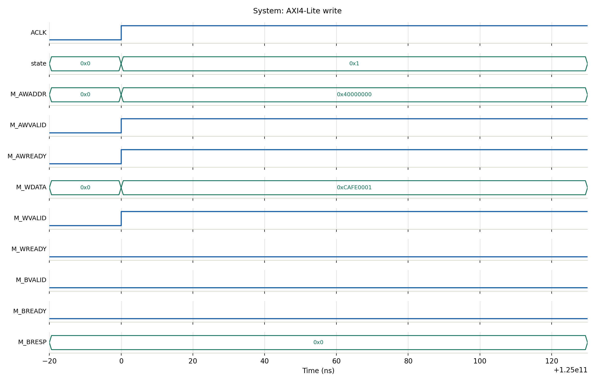
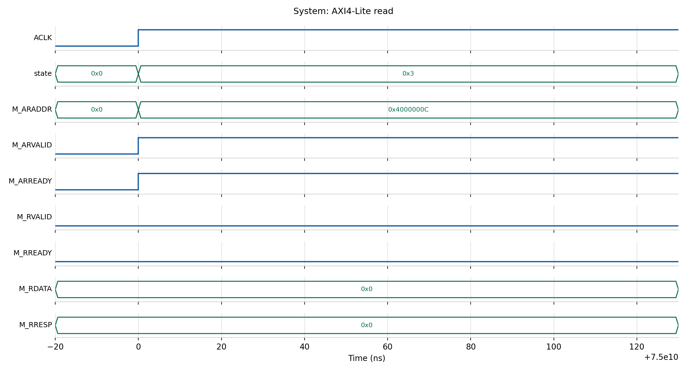
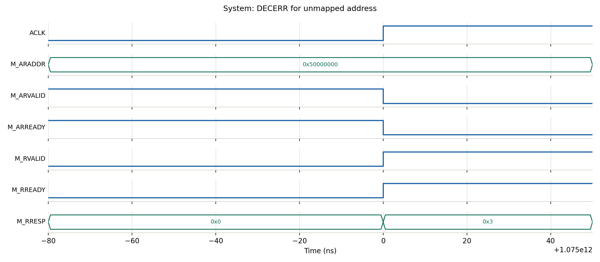
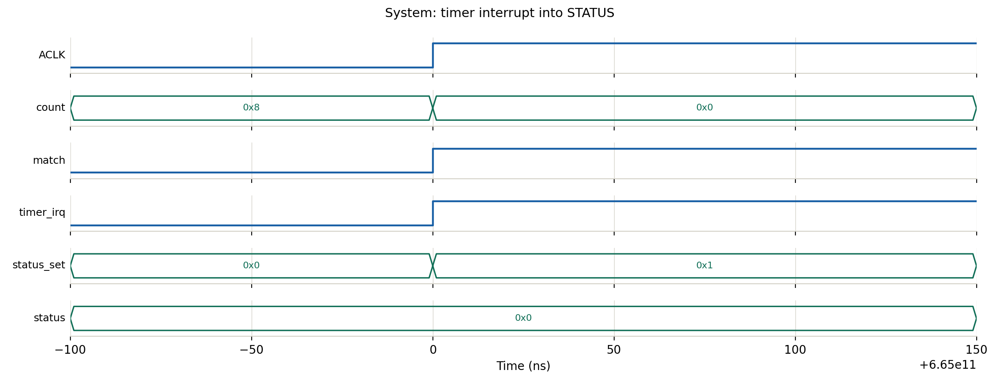

# AXI4-Lite Based Mini System-on-Chip Fabric

Design and verification of a small SoC subsystem in Verilog: one AXI4-Lite master,
an address-decoding interconnect and three memory-mapped peripherals (register bank,
GPIO, timer). Simulated with Icarus Verilog, synthesized with Yosys.

## Architecture

```
              +---------------------+
              |  axi_lite_master    |   command interface: start / rw / addr / wdata / wstrb
              +----------+----------+
                         |  AXI4-Lite
              +----------+----------+
              | axi_lite_interconnect|  address decoder + response mux (DECERR for unmapped)
              +----+--------+-------+
                   |        |       |
            +------+--+ +---+----+ +-+-------+
            |  regs   | |  gpio  | |  timer  |
            +---------+ +--------+ +---------+
```

| Base address | Slave | Registers (offset) |
|---|---|---|
| 0x4000_0000 | Register bank | CTRL 0x00 (RW), STATUS 0x04 (RW1C), DATA 0x08 (RW), ID 0x0C (RO) |
| 0x4001_0000 | GPIO | DIR 0x00, OUT 0x04, IN 0x08 (RO) |
| 0x4002_0000 | Timer | CTRL 0x00, COMPARE 0x04, COUNT 0x08 (RO), STATUS 0x0C (RW1C) |

Responses: OKAY (00), SLVERR (10) for read-only writes or bad offsets, DECERR (11) for unmapped addresses.

## Files

| File | Purpose |
|---|---|
| `axi_lite_master.v` | Synthesizable AXI4-Lite master FSM |
| `axi_lite_interconnect.v` | 1 master to 3 slaves interconnect |
| `axi_lite_regs.v`, `axi_lite_gpio.v`, `axi_lite_timer.v` | Slave peripherals |
| `axi_lite_soc_top.v` | Top level connecting everything |
| `axi_lite_mem_slave.v` | Simple slave model used only to test the interconnect |
| `tb_*.v`, `tb_common.vh` | Self-checking testbenches and shared test tasks |
| `run_all.sh` | Compile and run every testbench |
| `make_all_waveforms.sh`, `waveform_tools/plot_vcd.py` | Create waveform PNGs from the VCD files |
| `waveforms/` | Generated waveform images (system and per block) |

## How to run

```
bash run_all.sh                 # runs all testbenches, prints PASS/FAIL
pip install matplotlib
bash make_all_waveforms.sh      # creates waveforms/<block>/*.png
```

Requires Icarus Verilog (`iverilog`, `vvp`) and Python 3 with matplotlib.

## Verification results

All testbenches pass with Icarus Verilog.

| Testbench | Checks passed |
|---|---|
| Master | 8 |
| Register bank | 14 |
| GPIO | 10 |
| Timer | 13 |
| Interconnect | 15 |
| Full system | 13 |

## Synthesis results (Yosys, generic gate level)

| Module | Cells | Flip-flops |
|---|---|---|
| axi_lite_master | 190 | 143 |
| axi_lite_interconnect | 351 | 10 |
| axi_lite_regs | 544 | 184 |
| axi_lite_gpio | 368 | 168 |
| axi_lite_timer | 520 | 156 |
| **Total (top)** | **1975** | **662** |

The Yosys CHECK pass reported 0 problems (no latches, no combinational loops).

## Waveforms






Per-block waveforms are in `waveforms/master`, `waveforms/regs`, `waveforms/gpio`,
`waveforms/timer` and `waveforms/interconnect`.
